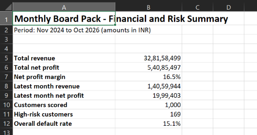
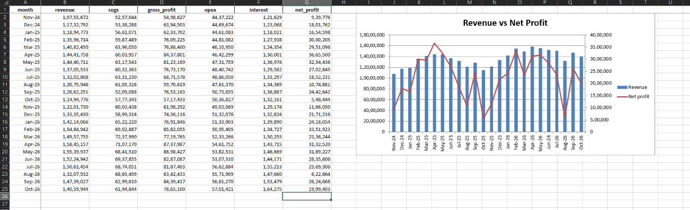
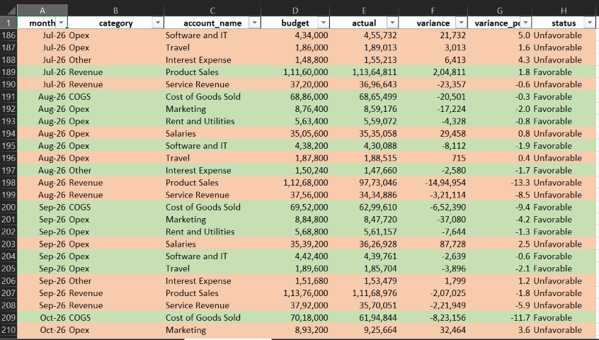
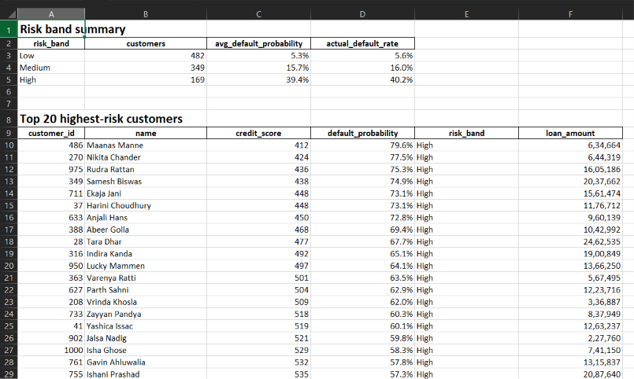

# DA-04: Financial Analytics and Risk Reporting System

An automated reporting pipeline that produces a monthly profit and loss statement, a budget vs actual variance report, customer credit risk scores, and an Excel board pack, all from synthetic data in one command.

## Architecture

```
generate_data.py -> load_db.py -> run_queries.py -> credit_risk.py -> build_board_pack.py
   (CSV files)      (SQLite)      (SQL -> CSV)      (scikit-learn)       (Excel workbook)
```

| Step | Script | Output |
|------|--------|--------|
| 1. Synthetic data | `src/generate_data.py` | 5 CSVs in `data/raw/` |
| 2. Database | `src/load_db.py` | `data/processed/finance.db` (SQLite) |
| 3. SQL reports | `src/run_queries.py` + `sql/*.sql` | `reports/pnl.csv`, `reports/budget_vs_actual.csv` |
| 4. Credit risk | `src/credit_risk.py` | `credit_scores` table + `reports/credit_scores.csv` |
| 5. Board pack | `src/build_board_pack.py` | `reports/board_pack.xlsx` |
| Orchestration | `src/run_pipeline.py` | Runs all steps, saves a dated copy |

## Tools

Python (pandas, scikit-learn, XlsxWriter), SQL (SQLite), Excel (board pack). Power Automate is replaced by `run_pipeline.py`, which can be scheduled with Windows Task Scheduler and optionally emails the board pack.

## Setup

```
git clone https://github.com/Sricharan927/da04-financial-risk-reporting.git
cd da04-financial-risk-reporting
python -m venv venv
venv\Scripts\Activate.ps1
pip install -r requirements.txt
python src/run_pipeline.py
```

Close `reports/board_pack.xlsx` in Excel before running, or the final step cannot overwrite it.

## Data

All data is synthetic (seeded, so results are reproducible). Financials cover Nov 2024 to Oct 2026 across 9 accounts and 5 departments (1,080 rows each for budget and actuals), in INR. There are 1,000 customers with loan and credit history.

## Credit risk model

A logistic regression predicts default from credit utilization, late payments, existing debt ratio, loan-to-income, employment years and age. Customers get a default probability, a credit score (300 to 850) and a risk band (Low under 10%, Medium 10 to 25%, High above 25%).

- **Test ROC AUC: 0.712.** Accuracy is not reported as a headline because only 15% of customers default, so predicting "no default" for everyone already scores about 85%.
- **Validation by band** (actual default rates):

| Risk band | Customers | Default rate |
|-----------|-----------|--------------|
| Low | 482 | 5.6% |
| Medium | 349 | 16.0% |
| High | 169 | 40.2% |

Limitation: band rates are computed on all 1,000 customers, including the 750 used for training, so they are slightly optimistic.

## Board pack

| Sheet | Contents |
|-------|----------|
| Summary | Revenue, net profit, margin, high-risk count, default rate |
| Monthly PnL | 24-month P&L with revenue vs net profit chart |
| Budget vs Actual | Variance by account and month, red/green status formatting |
| Credit Risk | Band summary and top 20 highest-risk customers |






## Testing

```
python -m pytest tests -v
```

Six tests check row counts, that the P&L reconciles (revenue - COGS - opex - interest = net profit), that no month is in the future, that every budget line has a matching actual, that default rates rise from Low to High, and that scores are in valid ranges.

## Email (optional)

`python src/run_pipeline.py --email` sends the board pack by Gmail SMTP. Set `SMTP_USER`, `SMTP_APP_PASSWORD` and `EMAIL_TO` as environment variables. Credentials are never stored in the repo.